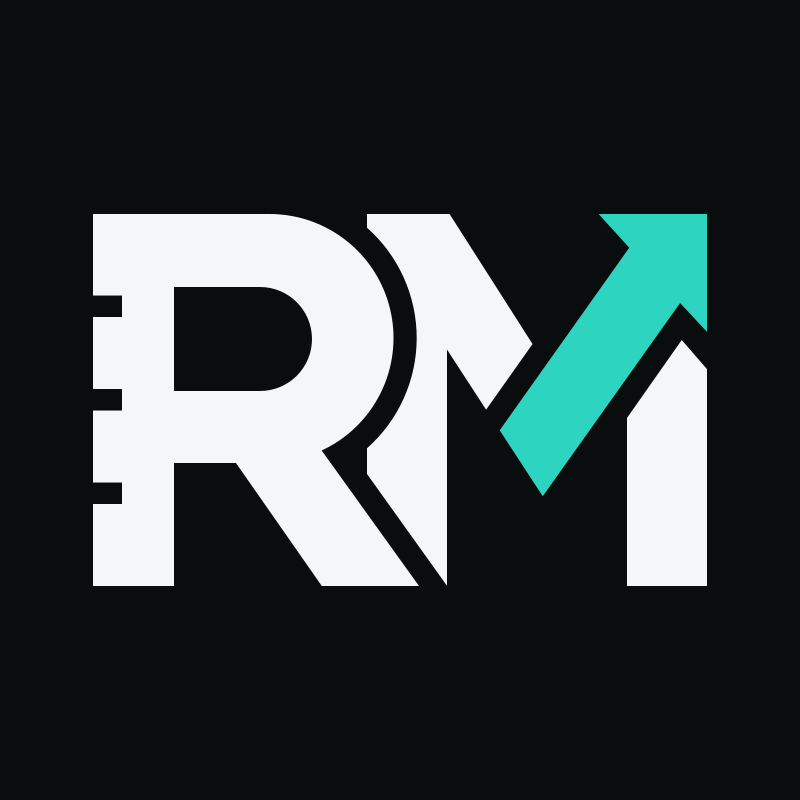

<p align="center">
  
</p>

<h1 align="center">RackMark</h1>

<p align="center">
  Cuaderno de entrenamiento de fuerza, análisis de progresión y seguimiento físico (PWA offline-first).<br />
  <a href="https://rackmark.web.app"><strong>https://rackmark.web.app</strong></a>
</p>

<p align="center">
  <a href="https://github.com/Victor-Blasco/RackMark/actions/workflows/ci.yml">
    
  </a>
</p>

---

## Funcionalidades principales

- **Entrenar (`En vivo` y `Registrar hecho`):** registro rápido en gimnasio pensado para usar con una mano en móvil, un ejercicio activo a la vez, cronómetro de descanso manual/automático, notas por sesión o fijas y resumen al completar.
- **Análisis de fuerza y progresión:** cálculo de 1RM estimado (Epley), detección automática de récords, progresión o estancamiento y sugerencias de carga.
- **Volumen semanal efectivo:** reparto por grupo muscular (principal `1`, secundario `0,5`) frente a rangos óptimos según disponibilidad.
- **Adherencia y bienestar:** calendario mensual, rachas, cardio, sueño, HRV y pasos diarios con importación directa de archivos ZIP/CSV de **Samsung Health**.
- **Cuerpo y calculadoras:** evolución de peso con media móvil de 7 días, composición corporal, perímetros, importación/plantilla CSV y planificador calórico/macros (Katch-McArdle).
- **Planificación:** rutinas personalizables (Push/Pull/Leg, Torso/Pierna, Full Body, Weider o propias), catálogo muscular, fusión de ejercicios duplicados y fases de entrenamiento.
- **Coach IA (opcional):** análisis periódico mediante Firebase AI Logic (Gemini) en modo sencillo o técnico.
- **Offline-first + Nube:** persistencia local en IndexedDB con sincronización bidireccional en Cloud Firestore e inicio de sesión con Google.

## Stack técnico

- **Frontend:** Preact, TypeScript, Tailwind CSS, Chart.js, Phosphor Icons
- **Build y PWA:** Vite, `vite-plugin-pwa` (Workbox)
- **Datos y nube:** IndexedDB, Web Worker (`fflate` + `papaparse`), Firebase Auth, Cloud Firestore y Firebase AI Logic
- **Tests:** Vitest + `preact-render-to-string`

## Desarrollo local

Requisitos: Node.js 20+ y npm.

```bash
npm install
```

Si quieres habilitar App Check en entorno local, copia `.env.example` a `.env.local` y añade tu clave pública de reCAPTCHA Enterprise:

```bash
cp .env.example .env.local
```

Comandos disponibles:

```bash
npm run dev      # Servidor de desarrollo Vite
npm test         # Suite de tests (Vitest)
npm run build    # Comprobación de tipos (tsc --noEmit) + build de producción en dist/
npm run preview  # Previsualización local del build
```

## Despliegue en Firebase Hosting

El proyecto está configurado con multisite en [firebase.json](firebase.json) y [.firebaserc](.firebaserc):

- `rackmark` → `https://rackmark.web.app` (sitio principal de la aplicación)
- `legacy` → `https://gymapp-vbg.web.app` (redirección `301` hacia `https://rackmark.web.app`)

Para compilar y desplegar:

```bash
npm run build
npx firebase-tools deploy --only hosting,firestore:rules
```

> **Nota de autenticación:** tras activar `https://rackmark.web.app`, asegúrate de tener `rackmark.web.app` añadido en **Firebase Console → Authentication → Settings → Authorized domains** para que funcione el inicio de sesión con Google.

## Privacidad

Consulta la política de privacidad en [https://rackmark.web.app/privacidad](https://rackmark.web.app/privacidad).

## Licencia

Distribuido bajo la licencia **Apache 2.0**. Consulta el archivo [LICENSE](LICENSE) para más detalles.
